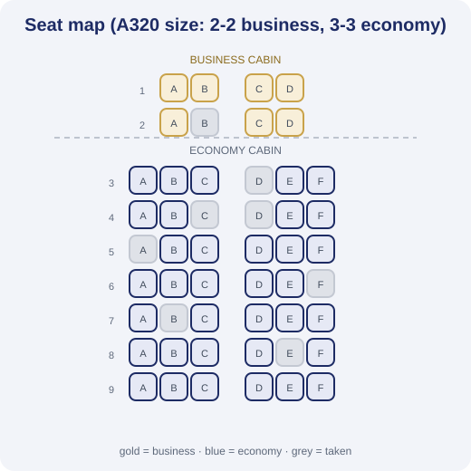
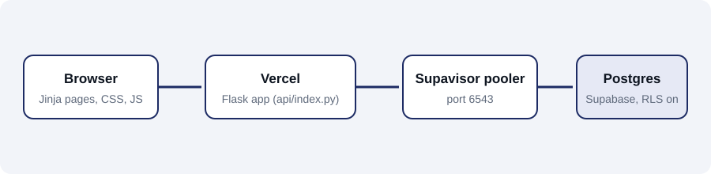

<p align="center"></p>

# Aerion - Airline Management System

Database course project (CSAI 202, Zewail City). A Flask + PostgreSQL web app where passengers search flights and pick their seat on a cabin map, staff handle check-in and baggage, and admins manage the fleet, flights and users.

Live demo: https://flyaerion.vercel.app

## What it does
- Search flights by destination. Origin and date are optional, the nearest flights come first.
- Seat map like a real aircraft: business in front, economy behind, aisle, row numbers, exit rows. The layout depends on the aircraft size (3-3 on small planes, 2-4-2 and 3-4-3 on wide-bodies).
- Different price per class. Fares follow the distance of the route (business is 2.8x economy).
- Loyalty miles: every booking earns miles (business earns double). Every 40 miles gives 10% off, up to 30%.
- Booking needs login, and after login you come back to the same seat map.
- Staff can book at the counter for a passenger. A passenger cannot open staff or admin pages.
- Admin: airports, routes, aircraft, flights (seats are generated from the aircraft), users, reports.

<p align="center"></p>

## ER diagram
Chen notation, made from the course lectures (entities, attributes, weak entity, cardinalities). The editable file is `docs/er-diagram.drawio` (open it in draw.io).

<p align="center"></p>

## How it is built
<p align="center"></p>

Python 3.12, Flask, Flask-SQLAlchemy, Jinja, plain CSS and JS. SQLite locally and PostgreSQL (Supabase) when hosted. The schema is in `airline_schema.sql`. Seat layouts are in `seatmap.py`.

Security: CSRF token on every POST, hashed passwords, role checks on every staff/admin route, login rate limiting, row level security on the Supabase tables.

## Demo accounts
| Role | Username | Password |
|---|---|---|
| Passenger | passenger1 ... passenger5 | password123 |
| Staff | staff1 ... staff3 | password123 |
| Admin | admin1 | admin123 |

These are demo accounts only. Change them before using the project for anything real.

## Run locally
```
python -m venv .venv
source .venv/bin/activate        # Windows: .venv\Scripts\activate
pip install -r requirements.txt
python app.py
```
The SQLite database and demo data are created on the first run.

## Tests
```
python -m pytest -q tests
```

## Deploy (Vercel)
`api/index.py` is the entry point. Environment variables:
- `DATABASE_URL` - Supabase transaction pooler connection string
- `SECRET_KEY` - long random string
- `APP_ENV=production`
- `SESSION_COOKIE_SECURE=true`
